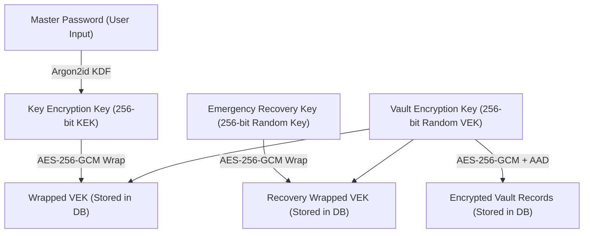

# PassEnd Pro — Security Architecture & Threat Model (`SECURITY_MODEL.md`)

This document defines the zero-knowledge cryptographic architecture, key derivation parameters, authenticated encryption envelope, and threat model for PassEnd Pro.

---

## 1. Zero-Knowledge Cryptographic Principle

PassEnd Pro is architected so that **the server never receives, logs, or stores**:
- The user's Master Password.
- Unwrapped cryptographic keys: Key Encryption Key (KEK) or Vault Encryption Key (VEK).
- The Emergency Recovery Key.
- Plaintext vault item payloads (usernames, passwords, secure notes, URLs, TOTP seeds).

All cryptographic operations occur exclusively client-side in the user's browser memory using Web Crypto APIs and WebAssembly (Argon2id in a background Web Worker).

---

## 2. Key Hierarchy & Derivation Parameters



### 2.1 Master Password Key Derivation (Argon2id)
- **Algorithm:** Argon2id (RFC 9106) executed in a dedicated Web Worker via `hash-wasm`.
- **Salt:** 16 cryptographically secure random bytes (`crypto.getRandomValues`), stored in Base64 in the user's profile.
- **Memory Cost (`memoryKiB`):** 19,456 KiB (19 MiB).
- **Time Cost (`iterations`):** 2 passes.
- **Parallelism (`parallelism`):** 1 thread.
- **Hash Length (`hashLength`):** 32 bytes (256 bits).
- **Normalization:** Unicode Normalization Form KC (NFKC) applied prior to UTF-8 encoding.

### 2.2 Vault Encryption Key (VEK)
- **Generation:** 32 cryptographically secure random bytes (256-bit entropy) generated via `crypto.getRandomValues`.
- **Lifecycle:** Resides in volatile client memory (`Uint8Array`) while the vault is unlocked.
- **Memory Zeroing:** Wiped via `wipeBytes` on manual lock, auto-lock timeout, tab logout, or window unload.

### 2.3 Emergency Recovery Key
- **Entropy:** 256 bits of cryptographically secure random bytes (32 random bytes).
- **Display Format:** 64 hexadecimal characters formatted into 4-character hyphenated blocks (`xxxx-xxxx-...-xxxx`) for readability without reduction of entropy.
- **Key Envelope:** Wraps the VEK using AES-256-GCM with a fresh 12-byte IV and Additional Authenticated Data (`userId` + `"recovery-key-wrap"` + version).
- **Invalidation:** Regenerating a recovery key immediately re-wraps the VEK with a new 256-bit random key and overwrites the recovery envelope in the database; the previous key is rendered mathematically invalid.

---

## 3. Authenticated Encryption Envelope (AES-256-GCM)

All vault records and key wraps use Authenticated Encryption with Associated Data (AEAD) via AES-256-GCM.

### 3.1 Vault Record Envelope
```json
{
  "id": "16-byte random hex string",
  "encryptedData": "Base64-encoded AES-256-GCM ciphertext + 16-byte tag",
  "iv": "Base64-encoded 12-byte IV",
  "cryptoVersion": 1,
  "version": 1,
  "isFavorite": false
}
```

### 3.2 Additional Authenticated Data (AAD) Binding
To prevent ciphertext substitution and cross-user / cross-item re-binding attacks:
- **Record Encryption AAD:** UTF-8 encoded `${userId}:${itemId}:v1`.
  - If an attacker copies an encrypted record from User A to User B or changes an item's ID, the GCM authentication tag check fails and decryption is rejected.
- **Key Wrap AAD:** UTF-8 encoded `${userId}:vault-key:v1`.
- **Recovery Wrap AAD:** UTF-8 encoded `${userId}:recovery-key-wrap:v1`.

---

## 4. Metadata Disclosure & Visible Fields

In compliance with zero-knowledge architectural standards, operational metadata visible to the server and database is strictly limited:

| Field Name | Encryption Status | Purpose & Visibility |
| :--- | :--- | :--- |
| `userId` / `_id` | Unencrypted | Authenticated user ownership (Clerk ID) |
| `id` (Item ID) | Unencrypted | Unique 16-byte random hex identifier |
| `version` | Unencrypted | Optimistic concurrency control number |
| `isFavorite` | Unencrypted | Client UI filtering preference |
| `isTrash` / `trashedAt` | Unencrypted | 30-day soft-delete retention lifecycle |
| `createdAt` / `updatedAt`| Unencrypted | Timestamp sorting |
| `encryptedData` | **Encrypted** | AES-256-GCM ciphertext containing all secrets |
| `iv` | Unencrypted | 12-byte initialization vector (unique per write) |
| `cryptoVersion` | Unencrypted | Cryptographic envelope version identifier |

### Sealed Inside `encryptedData` (Zero Server Visibility):
- Item Type (`login` vs `note`)
- Title
- Category / Tags
- Website URL
- Username
- Password
- Markdown Note Content
- TOTP Seed & Configuration

---

## 5. Data Portability & Backup Threat Model (`.passend`)

### 5.1 Minimal Manifest
The unencrypted manifest of an exported `.passend` backup file contains only:
- `format`: `"passend-backup"`
- `version`: `1`
- `exportedAt`: ISO 8601 timestamp
- `itemCount`: Total records count
- **Zero secrets, titles, URLs, or usernames appear in the manifest.**

### 5.2 Offline Attack Boundary
- Anyone who obtains a `.passend` archive possesses the Argon2id parameters and the KEK-wrapped VEK.
- While the wrapped key is secured by AES-256-GCM and Argon2id (19MB memory), an offline dictionary or brute-force attack can be attempted against weak Master Passwords.
- **Mitigation:** The application explicitly warns users of offline attack risks and prompts users to maintain a strong Master Password (minimum 12 characters) and store backup files on encrypted drives or cold storage.

### 5.3 Safe Restoration & Duplicate Handling
- Restoration unwraps the source VEK locally using the source password or source recovery key.
- Each record is decrypted, validated against Zod schemas, assigned a new random item ID, and re-encrypted with the destination vault's current VEK and fresh random IVs.
- **Merge Mode:** Skips records matching existing decrypted titles.
- **Replace Mode:** Requires explicit destructive confirmation before clearing existing records; existing records are only cleared after local decryption succeeds.

---

## 6. Infrastructure Hardening & Defense in Depth

1. **Content Security Policy (Enforcing Mode):**
   - Strictly enforces `default-src 'self'`, `object-src 'none'`, `base-uri 'self'`, and `frame-ancestors 'none'`.
   - Production builds strictly exclude `'unsafe-eval'`.
2. **Serverless Abuse Controls & Rate Limiting:**
   - Distributed Upstash Redis rate limiting with automatic in-memory fallback.
   - Read routes: 60 req/min; Write routes: 20 req/min; Batch routes: 15 req/min.
3. **Request Body Size Limits:**
   - Single item mutations: 100 KB max (`MAX_JSON_BODY_BYTES`).
   - Backup imports: 25 MB max (`MAX_BACKUP_BYTES`).
4. **Optimistic Concurrency Control:**
   - Route handlers enforce atomic updates conditioned on the item's `version`. Concurrent writes return HTTP `409 Conflict`.
5. **Multi-Tab Synchronization:**
   - `BroadcastChannel` synchronizes `VAULT_LOCKED`, `SESSION_SIGNED_OUT`, and `VAULT_MUTATED` events across browser tabs.
   - Incoming messages are strictly validated; any message containing secret fields (`key`, `password`, `secret`, `vek`) is instantly rejected.
